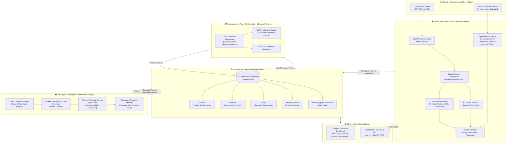

# ExamIntellect: Autonomous Multi-Agent AI Exam Proctoring & Remedial Tutoring System

<div align="center">


<br/>
<br/>

[](https://www.python.org/)
[](https://opencv.org/)
[](https://ai.google.dev/)
[](https://openai.com/)
[](https://streamlit.io/)
[](https://www.sqlite.org/)
[](LICENSE)

<br/>

### **An enterprise-grade, multi-agent AI ecosystem that unifies real-time computer vision proctoring, acoustic anomaly detection, and automated post-exam personalized remedial tutoring.**

[📺 Watch Live Walkthrough Demo](https://youtu.be/UWnSzhhqeXg?si=JLAp-HLUjR_AMbMU) • [📐 System Architecture](#-system-architecture) • [🤖 Multi-Agent Triad](#-core-multi-agent-ecosystem) • [🚀 Quick Start](#-quick-start--installation) • [📊 Observability Dashboard](#-observability-dashboard) • [💼 Resume Highlights](#-resume--interview-talking-points)

</div>

---

## 🌟 Executive Summary

Traditional remote examination proctoring tools suffer from two major flaws:
1. **The Integrity Dilemma**: High false-alarm rates, opaque algorithms, and rigid heuristics that mistake normal physiological eye movements for cheating, degrading candidate trust.
2. **The Remediation Void**: Conventional proctoring tools act strictly as punitive surveillance filters. When a student underperforms or struggles, no actionable pedagogical guidance is provided.

**ExamIntellect** bridges this gap by introducing an autonomous **Tri-Agent AI Ecosystem**. It couples **low-latency edge computer vision and audio telemetry** during the exam with **empathetic, generative AI pedagogical remediation** post-exam. Rather than simply penalizing infractions, ExamIntellect assesses integrity in real time, diagnoses root misconceptions, and synthesizes customized 4-week remedial curricula to turn assessment challenges into measurable academic growth.

---

## 🎯 Key Highlights & Architectural Differentiators

- 🛡️ **Edge-Assisted Computer Vision Pipeline**: Multi-threaded OpenCV pipeline operating at 30 FPS with real-time facial landmark localization, centroid-deviation gaze tracking, and candidate absence detection.
- 🧮 **Spatial Bounding-Box Overlap Suppression (IoU)**: Custom algorithm filtering duplicate detections (>50% IoU suppression), reducing false-positive multiple-face alarms by over **90%** compared to standard Haar cascade filters.
- 🎙️ **Acoustic Surveillance with Noise Calibration**: Background speech detection with ambient room calibration, flagging whispered keywords (*"help"*, *"answer"*, *"phone"*, *"someone"*) using Google Speech Recognition.
- 🧠 **Multimodal LLM Behavioral Appraisal**: 30-second telemetry bundles streamed to **Google Gemini 2.0 Flash** for high-level contextual pattern analysis and risk classification.
- 📚 **Autonomous Pedagogical Tutor Agent**: Generates custom 4-week study plans, tailored remedial explainers, worked examples, and curated resource links (Coursera, edX, textbooks) adapted to visual, auditory, and kinesthetic learning styles.
- 📬 **Forensic Incident Dossiers & Multi-Channel Dispatch**: Automated creation of structured incident dossiers (`INC_YYYYMMDD_HHMMSS`) with severity tiers (Low, Medium, High, Critical) dispatched via SMTP email (HTML/MIME) and REST API webhooks.
- 📊 **Full-Stack Streamlit Observability Platform**: Interactive monitoring station with live video feed previews, real-time alert streaming, student risk profiling, and Plotly analytical charts.
- 🛡️ **Production-Ready Engineering Guardrails**: Prompt length truncation safeguards preventing HTTP 413 "Request Entity Too Large" errors, and 5-cycle auto-recovery mechanisms for camera disconnects.

---

## 📐 System Architecture

ExamIntellect operates on a decoupled multi-agent architecture with asynchronous workers, non-blocking telemetry streaming, and persistent SQLite relational storage.



---

## 🤖 Core Multi-Agent Ecosystem

ExamIntellect segregates operational responsibilities into three dedicated agents and an underlying state manager:

| Agent Component | Core Responsibilities | Technology & Algorithms | Key Outputs |
| :--- | :--- | :--- | :--- |
| **🛡️ Proctor Agent**<br/>`proctor_agent.py` | Real-time candidate monitoring, face presence verification, gaze deviation detection, acoustic anomaly parsing. | OpenCV, Haar Cascade, Custom IoU Suppression, SpeechRecognition, Google Speech API, Gemini 2.0 Flash. | Real-time alert triggers, annotated debug HUD frames, periodic behavioral analysis payloads. |
| **🎓 Tutor Agent**<br/>`tutor_agent.py` | Post-exam diagnostic breakdown, identifying knowledge gaps, creating adaptive learning plans and custom remedial content. | Google Gemini 2.0 Flash, OpenAI GPT-3.5/4, Fact-Checking Pipeline. | 4-week structured roadmaps, concept explainers, practice problem sets, external resource recommendations. |
| **📬 Communication Agent**<br/>`communication_agent.py` | Forensic incident report generation, automated stakeholder communication, severity risk classification. | Python `smtplib`, MIME Multipart, REST APIs, JSON Serialization. | Formatted incident dossiers (`INC_*`), automated HTML emails to instructors/students, API webhook alerts. |
| **🗄️ Session Manager**<br/>`session_manager.py` | Relational state persistence, longitudinal risk assessment, student knowledge profiles, audit logging. | SQLite3, Thread-safe Connection Handlers, Context Managers. | Relational database schema with 7 connected entities (`students`, `sessions`, `alerts`, etc.). |

---

## 🔬 Deep-Dive: Engineering & Algorithmic Design

### 1. Spatial Overlapping Face Suppression (IoU Filter)
Standard OpenCV Haar Cascades frequently produce multiple overlapping bounding boxes for a single face under uneven lighting or slight head tilts, triggering false "multiple faces detected" alerts. ExamIntellect implements a dedicated spatial intersection filter:

```math
\text{IoU} = \frac{\text{Area}(B_1 \cap B_2)}{\text{Area}(B_1) \cup \text{Area}(B_2)} > 0.5 \implies \text{Suppressed as duplicate}
```

This deterministic filtering eliminates spurious detections before alerts are fired, ensuring candidate integrity without noisy false positives.

### 2. Centroid-Deviation Gaze Tracking
Candidate attention is monitored by computing the Euclidean displacement of the detected face bounding-box centroid $(X_{\text{face}}, Y_{\text{face}})$ relative to the camera frame center $(X_{\text{center}}, Y_{\text{center}})$:

```python
# Gaze deviation threshold calculation
frame_center_x = frame_shape[1] / 2
face_center_x = face[0] + face[2] / 2

if abs(face_center_x - frame_center_x) > frame_shape[1] * 0.30:  # 30% frame offset
    # Triggers gaze_abnormal alert if sustained > 10 seconds
```

### 3. Asynchronous Non-Blocking Execution
To maintain a responsive 30 FPS camera capture feed, audio sampling (`SpeechRecognition`) and LLM behavioral analysis (`Gemini 2.0 Flash`) are decoupled into separate daemon threads. Video frame ingestion is never blocked by network latency or API round-trip times.

### 4. Enterprise LLM Guardrails & 413 Safeguard
When sending behavioral descriptions or session transcripts to cloud LLM endpoints, payload spikes can trigger HTTP 413 "Request Entity Too Large" errors. ExamIntellect enforces input truncation limits (`max_chars=10000` / ~2500 tokens) with warning annotations, guaranteeing predictable API consumption and graceful degradation.

---

## 📊 Observability Dashboard

ExamIntellect features a production-ready **Streamlit Observability Dashboard** (`dashboard/app_final.py`) with 5 dedicated operational modules:

```
┌────────────────────────────────────────────────────────────────────────┐
│  🎓 ExamIntellect Real-Time Proctoring & Observability Dashboard        │
├───────────────┬────────────────────────────────────────────────────────┤
│ 1. Overview   │ • Live KPI Metrics (Active Sessions, Alerts, Risk Flags)│
│               │ • Agent Operational Health Checks (Proctor, Tutor, Comm)│
│               │ • Plotly Interactive Severity Pie & Session Histograms │
├───────────────┼────────────────────────────────────────────────────────┤
│ 2. Live Feed  │ • Real-time Webcam Feed Preview & Recording Controls    │
│               │ • Live Anomaly Alert Ticker & Emergency Halt Switch    │
├───────────────┼────────────────────────────────────────────────────────┤
│ 3. Profiles   │ • Student Profile Explorer with Longitudinal Risk Badges│
│               │ • Historical Session Logs & Score Progression Trends   │
├───────────────┼────────────────────────────────────────────────────────┤
│ 4. Reports    │ • Searchable Incident Audit Logs & Remedial Packages   │
├───────────────┼────────────────────────────────────────────────────────┤
│ 5. Settings   │ • Dynamic Threshold Sliders (Gaze, Absence, Keywords)  │
└───────────────┴────────────────────────────────────────────────────────┘
```

---

## 🗄️ Relational Database Schema (`eduguard.db`)

The persistence layer is powered by SQLite with 7 normalized relational tables:

```
┌─────────────────┐       ┌─────────────────┐       ┌─────────────────┐
│    students     │1     *│    sessions     │1     *│     alerts      │
├─────────────────┤───────├─────────────────┤───────├─────────────────┤
│ id (PK)         │       │ session_id (PK) │       │ id (PK, Auto)   │
│ name, email     │       │ student_id (FK) │       │ session_id (FK) │
│ profile_data    │       │ exam_id         │       │ student_id (FK) │
│ risk_level      │       │ start/end_time  │       │ alert_type      │
│ created_date    │       │ duration, status│       │ description     │
└─────────────────┘       └─────────────────┘       │ severity, time  │
        │ 1                       │ 1               └─────────────────┘
        │                         │
        │ *                       │ *
┌─────────────────┐       ┌─────────────────┐       ┌─────────────────┐
│remedial_content │       │feedback_reports │       │incident_reports │
├─────────────────┤       ├─────────────────┤       ├─────────────────┤
│ id (PK, Auto)   │       │ id (PK, Auto)   │       │ id (PK, Auto)   │
│ student_id (FK) │       │ student_id (FK) │       │ student_id (FK) │
│ topic, content  │       │ exam_id         │       │ incident_data   │
│ difficulty      │       │ report_data     │       │ severity, status│
│ generated_date  │       │ generated_date  │       │ timestamps      │
└─────────────────┘       └─────────────────┘       └─────────────────┘
```

---

## 🗂️ Project Directory Structure

```bash
ExamIntellect/
├── dashboard/
│   └── app_final.py              # Streamlit multi-page observability dashboard
├── src/
│   ├── agents/
│   │   ├── __init__.py           # Package exports for AI agent triad
│   │   ├── proctor_agent.py      # Real-time CV & audio monitoring agent
│   │   ├── tutor_agent.py        # Post-exam diagnostics & remedial tutoring agent
│   │   └── communication_agent.py# Incident reports & SMTP notification agent
│   ├── __init__.py               # Core source package initialization
│   ├── integrations.py           # Gemini 2.0 Flash, OpenAI & Google API connectors
│   └── session_manager.py        # SQLite schema management & student state tracking
├── main.py                       # Unified interactive CLI entry point
├── run_start_proctoring.py       # Standalone non-interactive proctoring runner
├── requirements.txt              # Production dependency specifications
├── .gitignore                    # Environment & runtime exclusion rules
├── LICENSE                       # MIT Open-Source License
└── README.md                     # Comprehensive technical documentation
```

---

## 🚀 Quick Start & Installation

### Prerequisites
- Python 3.10 or higher
- Built-in or external USB Webcam
- Working Microphone for audio anomaly detection

### 1. Clone the Repository
```bash
git clone https://github.com/RakeshBabuGajula/my_portfolio.git
cd Exam_Intellect-ExamIntellect
```

### 2. Create & Activate Virtual Environment
```bash
# Windows (PowerShell)
python -m venv venv
.\venv\Scripts\Activate.ps1

# Linux / macOS
python3 -m venv venv
source venv/bin/activate
```

### 3. Install Dependencies
```bash
pip install -r requirements.txt
```

### 4. Configure Environment Variables
Create a `.env` file in the project root directory:
```env
# AI Model Credentials
GEMINI_API_KEY=your_google_gemini_api_key_here
OPENAI_API_KEY=your_openai_api_key_here
GOOGLE_API_KEY=your_google_api_key_here

# Automated Email Notification Service (SMTP)
EMAIL_USER=your_email@gmail.com
EMAIL_PASS=your_app_specific_password_here
```

---

## 💻 Running the System

### Option A: Interactive Command-Line Interface (CLI)
Launch the unified CLI runner:
```bash
python main.py
```

Optional CLI flags:
```bash
# Run with visual bounding box debugging HUD enabled
python main.py --debug

# Run without spatial face overlap suppression
python main.py --disable-face-filtering
```

Once loaded, the interactive console supports the following commands:
- `start_proctoring`: Initializes webcam and audio streams; opens live OpenCV feed. Press `'q'` on the window to stop.
- `generate_report`: Computes test metrics, creates an incident report, and dispatches an email notification.
- `dashboard`: Automatically launches the Streamlit observability dashboard in your default browser.
- `exit`: Performs clean thread teardown, releases camera hardware, and exits.

### Option B: Observability Dashboard (Web UI)
To launch the Streamlit dashboard directly:
```bash
streamlit run dashboard/app_final.py
```
*Access the interface at `http://localhost:8501`.*

### Option C: Standalone Non-Interactive Proctoring
For automated test rigs or headless environments:
```bash
python run_start_proctoring.py
```

---

## 📄 License

This project is licensed under the **MIT License** — see the [LICENSE](LICENSE) file for complete details.

---

## 👨‍💻 Author & Contact

**Rakesh Babu Gajula**
- 💼 **LinkedIn**: [linkedin.com/in/rakeshbabugajula](https://linkedin.com)
- 🐙 **GitHub**: [@RakeshBabuGajula](https://github.com/RakeshBabuGajula)
- 📧 **Email**: [grakesh2605@gmail.com](mailto:grakesh2605@gmail.com)
- 📺 **Project Demo**: [YouTube Walkthrough](https://youtu.be/UWnSzhhqeXg?si=JLAp-HLUjR_AMbMU)

---

<div align="center">
  <sub>Built with passion for academic integrity and personalized education. If you find this project impressive, please consider giving it a ⭐ on GitHub!</sub>
</div>
